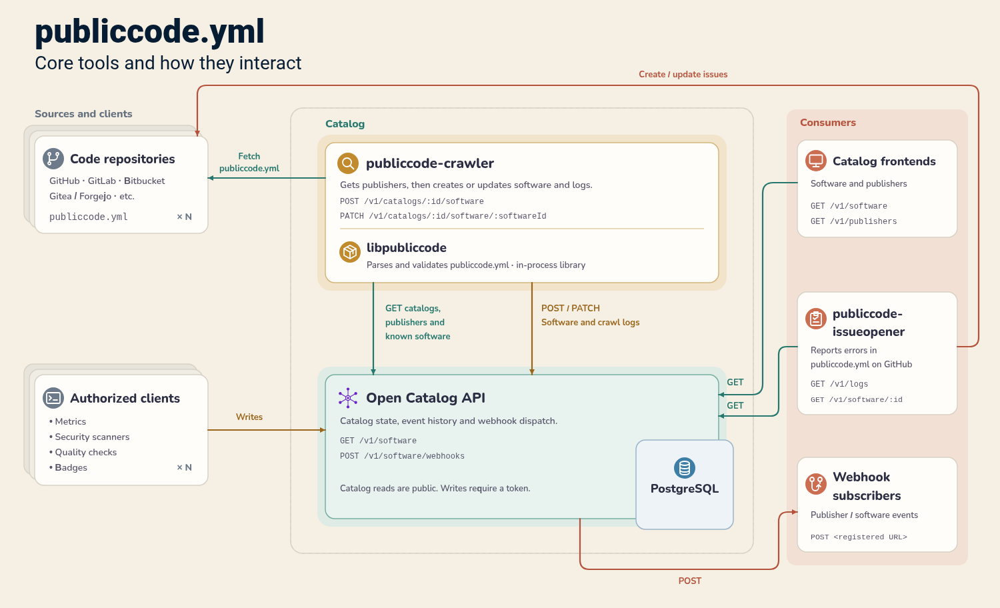

<!-- markdownlint-disable no-inline-html -->

<h1 align="center">The publiccode.yml Standard</h1>

<div align="center">
  <i>
    A metadata standard to describe software made by or for public
    administrations, making it discoverable and understandable for both
    developers and non-technical users.
  </i>
</div>

<br />

<div align="center">
  <h3>
    <a href="https://publiccodeyml.github.io">Website</a>
    <span> | </span>
    <a href="CONTRIBUTING.md">Contributing</a>
  </h3>
</div>

## What is `publiccode.yml`

Public administrations often create valuable software. Other
administrations rarely reuse it, because the software is hard to find. It
is also hard to tell whether a project fits another administration's
context.

`publiccode.yml` is a **human-readable and machine-readable metadata
file** placed in the root of a repository. It answers these questions:

- What does this project do? (name, description, languages)
- What is its status? (`concept`, `development`, `beta`, `stable`, `obsolete`)
- Who maintains it and until when?
- Who to contact for technical/support inquiries?
- What legal frameworks is it designed for?
- What are its dependencies?

It is designed to be **easy to add to any new project** and to **grow as
the project evolves**.

## Example

The example below follows the draft of version 1.0 of the Standard.
Validators accept it once a
[libpubliccode](https://github.com/publiccodeyml/libpubliccode) release
supports version 1.0. Until then, write `publiccodeYmlVersion: "0"` and
follow the [version 0 reference](https://publiccodeyml.github.io/v0/).

A minimal `publiccode.yml` file:

```yaml
publiccodeYmlVersion: "1"
name: My text editor
url: "https://example.com/mysoftware/text-editor.git"
softwareType: standalone/desktop
platforms:
  - windows
developmentStatus: development
description:
  en:
    shortDescription: A lightweight text editor
    longDescription: >
      A lightweight yet powerful text editor designed for everyday use by developers,
      writers and public administrations. It also supports syntax highlighting.
    features:
      - Syntax highlighting
      - Collaborative editing features
      - Scripting interface
legal:
  license: AGPL-3.0-or-later
maintenance:
  type: community
  contacts:
    - name: Margaret Hamilton
localisation:
  localisationReady: true
  availableLanguages:
    - en
    - de
    - fr
```

[**See all available fields...**](https://publiccodeyml.github.io/)

## Adding `publiccode.yml` to a project

1. Create a `publiccode.yml` file in the root directory of the repository,
   starting from the example above.
2. Check it with the
   [GitHub Action](https://github.com/publiccodeyml/publiccode-parser-action)
   or the
   [GitLab CI](https://github.com/publiccodeyml/publiccode-parser-gitlab-ci)
   job, so that every change to the file is validated.
3. Update the file when the project changes, for example its development
   status, maintainers or supported languages.

## Finding projects

Each code hosting platform has its own search. On GitHub, this search
finds every `publiccode.yml` file in the root directory of a repository:

- [GitHub Search `path:/^publiccode.yml$/`](https://github.com/search?q=path%3A%2F%5Epubliccode.yml%24%2F&type=code)

## Versioning

This project follows the [Semantic Versioning](https://semver.org/).

[See all versions](https://github.com/publiccodeyml/publiccode.yml/releases)

## Contributing

Read the [contributing guide](CONTRIBUTING.md) before opening an issue or
a pull request. Questions and proposals are welcome in
[Discussions](https://github.com/publiccodeyml/publiccode.yml/discussions).

Translations of the documentation live in
[publiccodeyml/translations](https://github.com/publiccodeyml/translations).

The [Standard's website](https://publiccodeyml.github.io) is built using the
Python Sphinx package and
[deployed](https://github.com/publiccodeyml/publiccodeyml.github.io/blob/main/.github/workflows/publish.yml)
on GitHub Pages from the
[publiccodeyml.github.io](https://github.com/publiccodeyml/publiccodeyml.github.io)
repository.

### Prerequisites

- [`uv`](https://docs.astral.sh/uv/getting-started/installation/)

### Local development process

Each major version of the Standard has its own directory, `spec/v0` and
`spec/v1`. `sphinx-build` compiles one of them to static HTML files. Run
this command to generate the version 1 website:

```console
uv run sphinx-build -W --keep-going -c . spec/v1 build
```

Then open a file of the build directory in a browser, for example
`build/index.html`. Use `spec/v0` instead for version 0.

#### Hot reloading

`sphinx-autobuild` rebuilds the website and reloads the browser on every
change. It watches only the source directory, so the `--watch` options
add the configuration, the styles and the templates of the site:

```console
uv run sphinx-autobuild spec/v1 build -c . --watch conf.py --watch _static --watch _templates
```

#### All the versions

The published website puts every major version of the Standard side by
side, one directory per major version (`/v0/`, `/v1/`, ...) with a
version switcher on each page. A major version with a release is built
from its newest release tag (`v0.8.0`, ...). A major version with no
release yet is built from the `spec/vN` directory of the last commit of
the current checkout, as a draft (`1.0-rc`, ...) marked by a banner.
Every version uses the `conf.py` and templates of the current checkout,
see `poly.py`. Tags come with the clone, then:

```console
uv run sphinx-polyversion poly.py build/html
```

To preview the draft with the switcher, uncommitted changes included,
without building the release tags:

```console
uv run sphinx-polyversion poly.py build/html -l
```

## Tooling

Tools and libraries that implement and support the publiccode.yml Standard.

### Core tools

Core tools are developed alongside the publiccode.yml specification and provide
its reference implementations and supporting components.

[](.github/images/core-tools.svg)

- **[libpubliccode](https://github.com/publiccodeyml/libpubliccode)**

  Parser and validator library. Reference implementation of the specification.

  - Bindings:
    [PHP](https://github.com/bfabio/publiccode-parser-php) (via FFI)
  - CI:
    [GitHub Action](https://github.com/publiccodeyml/publiccode-parser-action),
    [GitLab CI](https://github.com/publiccodeyml/publiccode-parser-gitlab-ci)
  - [Validator API](https://github.com/publiccodeyml/publiccode-validator-api):
    RESTful API returning validation errors and warnings

- **[publiccode-crawler](https://github.com/publiccodeyml/publiccode-crawler)**

  Crawler to discover and collect descriptor files for catalogs.

- **[open-catalog-api](https://github.com/publiccodeyml/open-catalog-api)**

  RESTful API powering software catalogs for public administrations, used to
  store, query and expose all catalog data about FLOSS solutions.

  - [CLI client](https://github.com/bfabio/publiccode-api-client) to query
    the catalog API (*alpha*)

- **[publiccode-issueopener](https://github.com/publiccodeyml/publiccode-issueopener)**

  Opens GitHub issues to repos in a software catalog with invalid publiccode.yml
  files.

- **[JSON Schema on SchemaStore](https://github.com/SchemaStore/schemastore/blob/master/src/schemas/json/publiccode.json)**

  JSON Schema definition mainly used by editors and IDEs for coarse validation
  and autocompletion.

### Third-party tooling

Maintained separately from the core tooling, but widely used in practice.

- **[publiccode-editor](https://github.com/italia/publiccode-editor)**

  User friendly editor and basic validator for publiccode.yml files (maintained
  by Developers Italia, Italian Government).

## License

Licensed under the [CC0-1.0](LICENSE).
